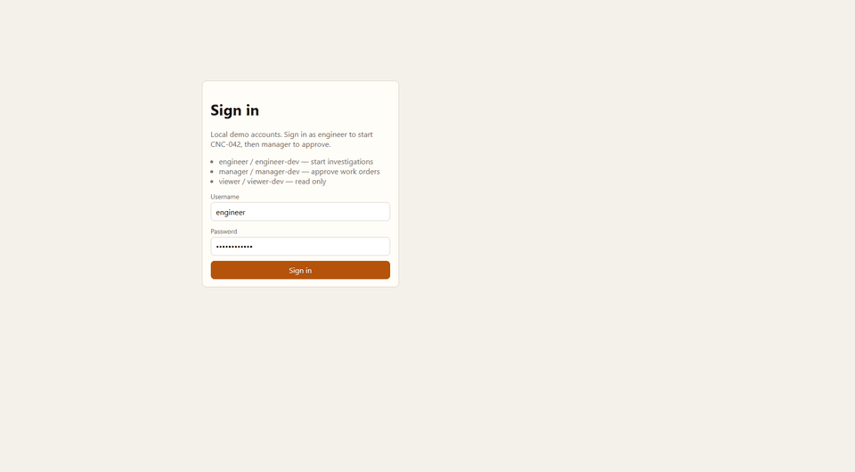
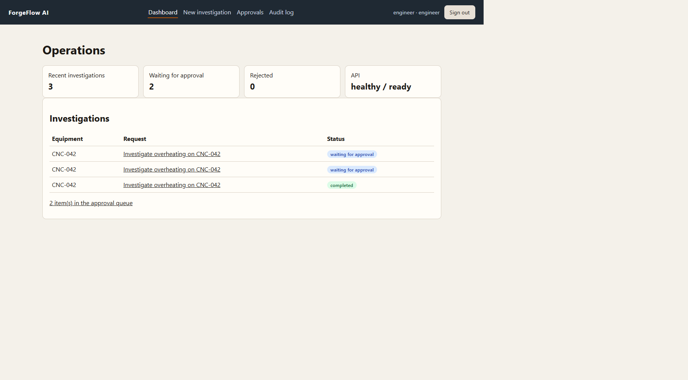
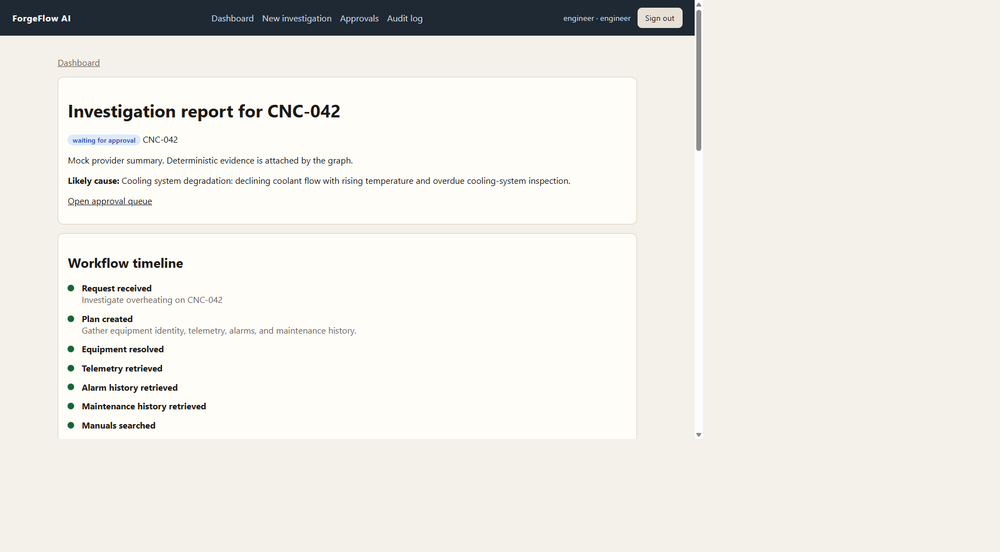
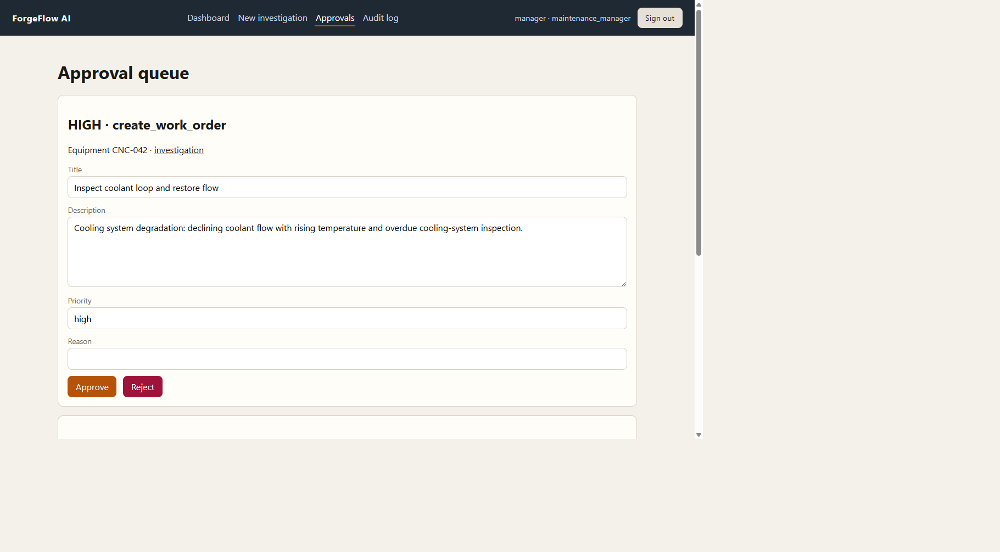
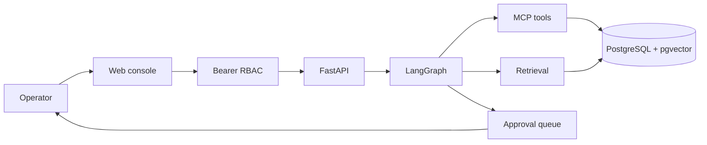

# ForgeFlow AI

An engineer files an operational request. The system plans an investigation, pulls equipment telemetry, alarms, maintenance history, and manual sections through MCP tools, then **stops for a human** before it can create a work order. The model never decides whether a write is allowed.

This is a **lab you can clone**, not a hosted product. The plant is synthetic. The default LLM is an in-process mock. Embeddings are hashed so CI never calls a paid API. Compose still persists investigations, the approval queue, audit events, and logins in PostgreSQL, so restarting the API does not wipe the demo.

```bash
git clone <repository-url>
cd forgeflow-ai
cp .env.example .env
docker compose up --build
docker compose exec api python -m forgeflow.domain.seed --reset
```

Open [http://localhost:3000](http://localhost:3000). Sign in as `engineer` / `engineer-dev`, run `Investigate overheating on CNC-042`, then approve as `manager` / `manager-dev`.

## Demo

Engineer investigation → manager approval → work order, captured from the running console:



Still frames and how to recapture: [docs/screenshots/README.md](docs/screenshots/README.md). Script: [docs/demo.md](docs/demo.md).

## Console

| Sign in | Operations dashboard |
| --- | --- |
|  |  |

| CNC-042 investigation | Approval queue |
| --- | --- |
|  |  |

Also in the repo: [new investigation](docs/screenshots/new-investigation.png) and [audit log](docs/screenshots/audit.png).

## Problem

Industrial investigations mix noisy operational data, technical manuals, and write actions that must not run unchecked. A chatbot wrapper around an LLM cannot own that workflow: authorization, tool execution, evidence, approval, and audit have to be software systems, with the model used only where judgment is actually required.

## What works today

- FastAPI application with versioned health, readiness, auth, equipment history, investigation, approval, and audit endpoints
- PostgreSQL 16 with pgvector: industrial tables, ingested manuals, graph checkpoints, investigations, approvals, audit events, and demo users
- Deterministic synthetic seed for five fictional machines, including CNC-042, plus fictional manuals
- MCP tools `get_equipment`, `get_sensor_history`, `get_alarm_history`, `get_maintenance_history`, `search_documentation`, and `create_work_order`
- LangGraph investigation: request → plan → retrieve operational data and manuals → evidence → report → propose write → interrupt → execute
- Hashed embeddings (no paid embedding API) stored with pgvector; Compose investigations search those rows, tests use the same hashed corpus in-process
- Deterministic approval policy plus RBAC: `create_work_order` needs `tools:write` and a human grant of that investigation's idempotency key
- Bearer-token login with viewer / engineer / maintenance_manager / admin roles; retrieved text cannot skip those checks
- LLM provider abstraction for OpenAI, Ollama, and an in-process mock (tests and the Compose default never call a paid API)
- React operations console: login, dashboard, investigation, evidence, tool calls, approval queue, audit log
- Synthetic evaluation harness (`python -m evals`) with JSON and Markdown reports from actual runs
- OpenTelemetry metrics for HTTP, agent runs, tools, retrieval, LLM calls, and approvals; Prometheus scrape at `/metrics`
- Docker Compose Prometheus (9090) and Grafana (3001) with a ForgeFlow operations dashboard
- pytest, ruff, mypy, Vitest, and a GitHub Actions workflow

See [docs/architecture.md](docs/architecture.md), [docs/security.md](docs/security.md), [docs/evaluation.md](docs/evaluation.md), [docs/observability.md](docs/observability.md), and [docs/local-development.md](docs/local-development.md).

## Architecture



The LLM is not a security boundary. Authorization, schema validation, and write-action gating live in application code.

## Technology stack

| Area | Choice |
| --- | --- |
| API | Python 3.12+, FastAPI, Pydantic v2 |
| Data | PostgreSQL 16, pgvector, SQLAlchemy 2, Alembic |
| Tools | MCP (`mcp` SDK) wrapping industrial queries and retrieval |
| Agent | LangGraph explicit state graph with interrupt + checkpointer |
| LLM | OpenAI, Ollama, or in-process mock |
| Embeddings | Deterministic hashed vectors (256-d); no paid embedding API |
| Web | React 19, TypeScript, Vite, nginx |
| Observability | OpenTelemetry metrics, Prometheus, Grafana |
| Packaging | Docker Compose |
| Quality | pytest, ruff, mypy, Vitest, GitHub Actions |

## Quick start

Requirements: Docker Desktop (or another Compose-compatible Docker engine). No Ollama or OpenAI key is required for the default mock provider. After the commands at the top of this README, the console, API, Prometheus, and Grafana are on the ports below.

| URL | Service |
| --- | --- |
| [http://localhost:3000](http://localhost:3000) | Operations console |
| [http://localhost:8000/docs](http://localhost:8000/docs) | OpenAPI |
| [http://localhost:8000/metrics](http://localhost:8000/metrics) | Prometheus scrape |
| [http://localhost:9090](http://localhost:9090) | Prometheus UI |
| [http://localhost:3001](http://localhost:3001) | Grafana (anonymous viewer; admin/admin) |

API checks:

```bash
curl http://localhost:8000/api/v1/health
curl http://localhost:8000/api/v1/ready
TOKEN=$(curl -s -X POST http://localhost:8000/api/v1/auth/login \
  -H "Content-Type: application/json" \
  -d "{\"username\":\"engineer\",\"password\":\"engineer-dev\"}" | python -c "import sys,json; print(json.load(sys.stdin)['access_token'])")
curl http://localhost:8000/api/v1/equipment/CNC-042 -H "Authorization: Bearer $TOKEN"
curl -X POST http://localhost:8000/api/v1/investigations \
  -H "Content-Type: application/json" -H "Authorization: Bearer $TOKEN" \
  -d "{\"request\":\"Investigate overheating on CNC-042\"}"
```

A CNC-042 investigation returns `status: awaiting_approval` and cites the fictional cooling manual. Approve as `manager` / `manager-dev`:

```bash
MANAGER=$(curl -s -X POST http://localhost:8000/api/v1/auth/login \
  -H "Content-Type: application/json" \
  -d "{\"username\":\"manager\",\"password\":\"manager-dev\"}" | python -c "import sys,json; print(json.load(sys.stdin)['access_token'])")
curl http://localhost:8000/api/v1/approvals -H "Authorization: Bearer $MANAGER"
curl -X POST http://localhost:8000/api/v1/approvals/<investigation_id>/approve \
  -H "Content-Type: application/json" -H "Authorization: Bearer $MANAGER" \
  -d "{\"decision\":\"approve\"}"
```

Set `LLM_PROVIDER=ollama` or `openai` in `.env` if you want a real model. Tests always use the mock provider. Compose sets `CHECKPOINT_BACKEND=postgres`; the default test suite uses in-memory checkpoints.

Default local credentials in `.env.example` are for development only. See [SECURITY.md](SECURITY.md).

## Demo scenario

CNC-042 (ForgeMach FX-400) has a planted last-30-day pattern:

- rising temperature
- declining coolant flow
- nine `TEMP_HIGH` alarms
- overdue cooling-system inspection
- no open work order for cooling
- a fictional FX-400 coolant-loop manual that describes that failure mode

An investigation for CNC-042 should produce FACT / INFERENCE / RECOMMENDATION findings that cite those signals and the manual, then wait for approval before creating a work order. Peer assets (PUMP-AX200, CONVEYOR-B17, PRESS-HYD-03, COMPRESSOR-C09) do not share that pattern and do not propose a protected write.

Step-by-step recording script: [docs/demo.md](docs/demo.md).

## Local checks (without Docker)

Python 3.12+ is required. On Windows, create a venv and install extras:

```powershell
python -m venv .venv
.\.venv\Scripts\Activate.ps1
python -m pip install -e ".[dev]"
ruff check forgeflow apps tests evals
ruff format --check forgeflow apps tests evals
mypy forgeflow apps evals
pytest
python -m evals
cd apps/web
npm ci
npm run lint
npm test
npm run build
```

Integration tests skip automatically when PostgreSQL is not reachable. Against a migrated database:

```powershell
alembic upgrade head
python -m forgeflow.domain.seed --reset
pytest -m integration
```

## Contributing and license

- [CONTRIBUTING.md](CONTRIBUTING.md)
- [SECURITY.md](SECURITY.md)
- MIT. See [LICENSE](LICENSE).
